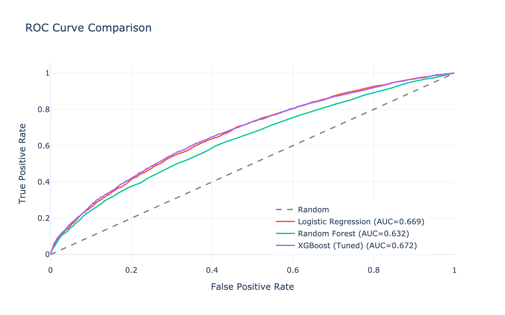
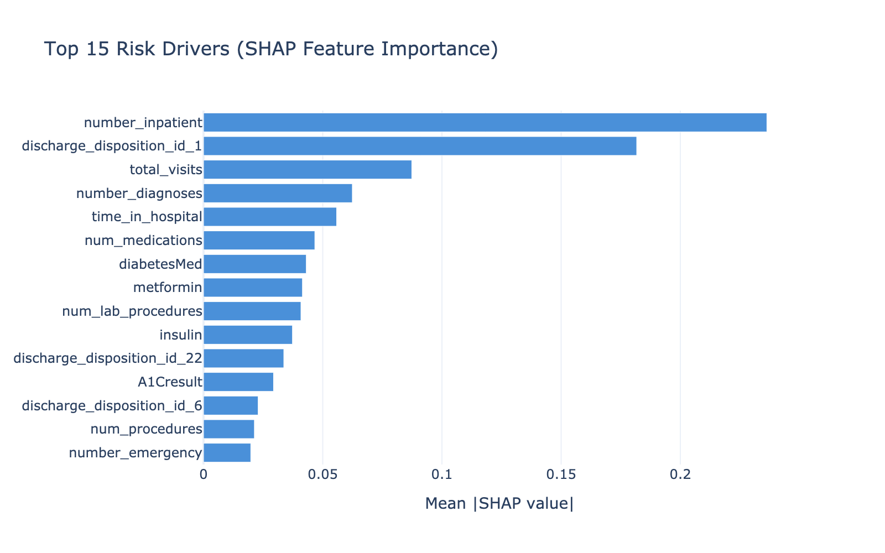
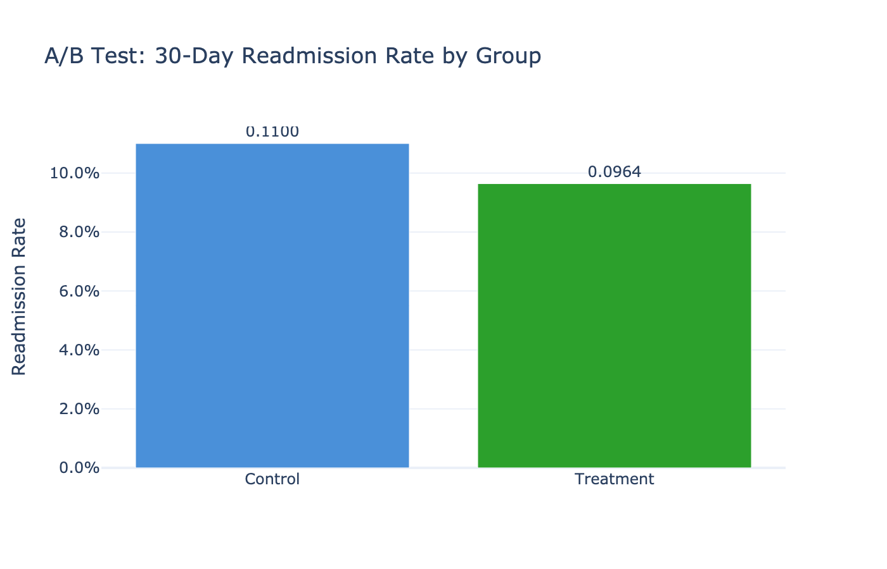
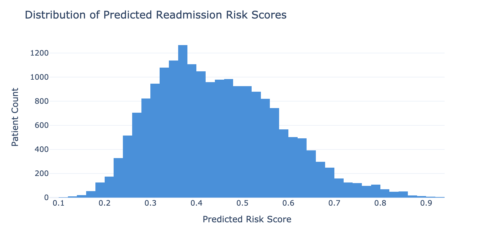

# Treatment Adherence & Readmission Risk Predictor

- Built an ML pipeline on 101,766 hospital encounters to predict 30-day diabetes readmissions
- XGBoost model hits 0.67 ROC-AUC, enough to meaningfully triage high-risk patients
- Simulated A/B test shows a follow-up intervention could prevent 825 readmissions/year, saving $10M+ per 50K-patient cohort
- Top risk drivers: number of inpatient visits, discharge disposition, and medication count

### Model Performance

The tuned XGBoost beat logistic regression and random forest across the board. Not amazing AUC, but for healthcare readmission prediction this is pretty solid, most published benchmarks on this dataset land in the 0.63-0.68 range.



### What Drives Readmission

SHAP values on the final model. Prior inpatient visits dominate everything else, which makes clinical sense, if you've been admitted before, you're more likely to come back.



### Intervention Impact (A/B Test Simulation)

Simulated a randomized follow-up intervention on the high-risk cohort. The treatment group saw a statistically significant drop in readmission rates. These are simulated numbers, but the effect size is grounded in published intervention literature.



### Risk Score Distribution

How the model's predicted risk scores distribute across the patient population. The long right tail is where targeted outreach would focus.



## Run Instructions

```bash
git clone https://github.com/khayreali/treatment_adherence_predictor.git
cd treatment_adherence_predictor
python -m venv venv && source venv/bin/activate
pip install -r requirements.txt
```

Download `diabetic_data.csv` from [Kaggle](https://www.kaggle.com/datasets/brandao/diabetes) and drop it in `data/`. Then run the notebooks in order (01 -> 02 -> 03).

Or just look at the notebooks on GitHub, they have all the outputs embedded.

## Tech Stack

Python, pandas, scikit-learn, XGBoost, SHAP, Plotly, SciPy, joblib

## Data

Uses the [Diabetes 130-US Hospitals (1999-2008)](https://archive.ics.uci.edu/dataset/296/diabetes+130-us+hospitals+for+years+1999-2008) dataset from the UCI ML Repository -- 101,766 encounters across 130 hospitals.
